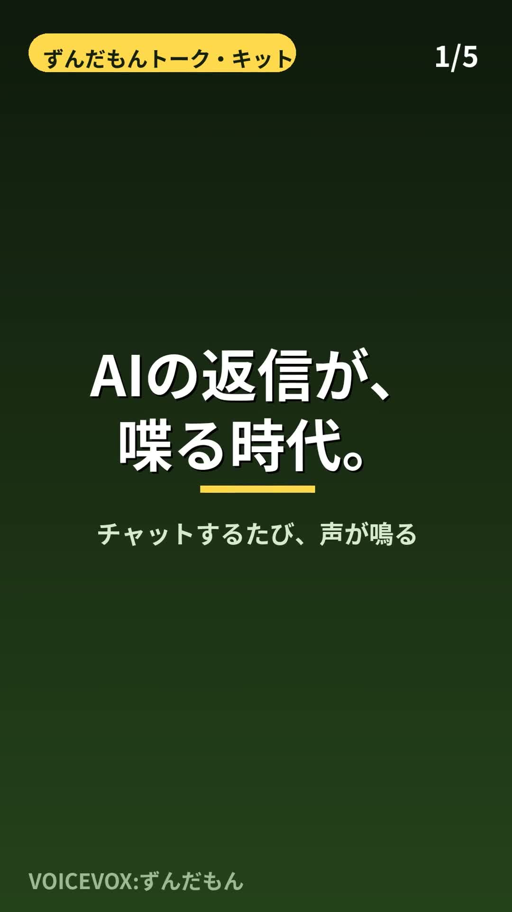

# ずんだもんトーク・キット

- AIアシスタント（Muse）の返信が、本物のずんだもんの声で鳴る
- 口調もずんだもん（文末は「〜なのだ」）
- 他のClaude／AIエージェントが `INSTALL.md` を読むだけで、そのまま導入できる



チャットの返信に合わせて、本物のずんだもんの声（VOICEVOX）をスマホのブラウザから自動で鳴らす仕組みと、ずんだもん口調の運用ノウハウ一式。2026-10-28に実機（Android / REDMI Note 15 Pro 5G + 本物のChrome）で検証しながら構築した記録。

本キットは非営利のファン活動として公開しています。クレジット：VOICEVOX:ずんだもん

**導入するエージェントへ：まず `INSTALL.md` の手順を順に実行し、`AGENT_RULES.md` を自分の振る舞い設定に取り込むこと。それだけで導入が完了するように作ってある。**

## 全体像

```
[AIの返信] --(合図: seq+slugを書く)--> [Googleスプレッドシート(状態セル)]
                                            ^ 約3秒おきに読む (gviz JSONP)
                                            |
[スマホのChrome: 待機ページ] --(新しいseqを検出)--> [対応フレーズのmp3を再生]
```

- AIは返信のたびに、趣旨に合うフレーズを1つ選び、合図（連番seqとフレーズID=slug）を状態シートに書き込む。
- 待機ページはシートをポーリングし、新しい合図を見つけたら埋め込み済みの音声サンプルを再生する。
- チャットへの音声ファイル添付では自動再生できない（タップ必須）ため、この「立てたページを鳴らす」方式が要る。

## 口調ルール（ずんだもん）

- 一人称は「ボク」。明るくフレンドリーに。文末は「〜（な）のだ」で締める。
- **「なのだ」は伸ばさない**（「なのだー」は不可）。短く切る。
- **合成テキストに小さい「っ」を付けない**：`なのだっ` と入力するとVOICEVOXが余分な「ッ」を発音して不自然になる。書き言葉でも合成入力でも正しい形は `なのだ`。本物のずんだもんは「なのだ」と書くだけで自然に短く切れる（実測：F0中央値 約348–381Hz、約8–9モーラ/秒、語尾は下降して短く切れる）。
- 名詞に付く形は「なのだ」、動詞・形容詞に付く形は「のだ」になる（例：了解なのだ／わかったのだ／すごいのだ）。フレーズ集はこの自然な表記で統一する。
- 関西弁は使わない（利用者の好み）。東北弁も付けない。方言ではなく語尾が本体。

## 声の用意（VOICEVOX）

- VOICEVOX engine 0.26.0（Linux CPU版、約1.85GB）を導入し、`./run --host 127.0.0.1 --port 50021` で起動。
- 話者は **ずんだもん ノーマル = スタイルID 3**。
- 合成は `POST /audio_query?text=...&speaker=3` → `POST /synthesis?speaker=3` の2段。wavをmp3に変換して使う。
- **品質チェック必須**：各サンプルの読み（kana）に `ノダ` が含まれ `ノダッ` が含まれないこと、長さが0.5–4秒に収まることを機械確認する。
- 内蔵TTSの似せ声は実測で却下された（F0約296Hzで低く・遅く・大人びた音色）。本物の声を使うのが正解。
- 再生成は `scripts/synthesize_samples.py`（フレーズ定義込み）。

## フレーズ集

- 32フレーズ＋トリガー用1フレーズ（ずんだオンにしたのだ）。カテゴリ：挨拶5／了解3／感謝・反応4／開始4／途中3／完了4／失敗3／お願い3／励まし2／締め1／トリガー1。
- 定義とメタデータは `samples/manifest.json` / `samples/manifest.md`。音声ファイル自体はこのリポジトリに含めない（合成スクリプトで再生成する）。

## オンオフ（トリガーワード）

- 利用者が「ずんだオン」と言う／タップ → ON。「ずんだオフ」→ OFF。
- 状態は状態ファイル（例：`zundamon-voice-state.json`、形式は `zundamon-voice-state.example.json`）に保持し、切り替えのたびに更新する。チャットが分かれても同じファイルを見ることで全体で一貫させる。
- **「ずんだオン」への返信は声付き**（専用サンプル「ずんだオンにしたのだ」）。**「ずんだオフ」への返信は声なし・テキストのみ**（オフだから）。オンとオフで返信の形も対にする。
- ONの間は返信1つにつき最大1フレーズ、趣旨に合うものだけを送る。合うものが無い返信には無理に付けない。
- **落とし穴**：フォークされた別チャットや専用チャットは、共有ファイルに書いただけでは新しい全体ルールを拾わないことがある（実例あり）。全体ルールを変えたら、稼働中の各チャットへ直接指示を送って適用させること。

## 合図チャネル（Googleスプレッドシート + gviz）

### なぜこの形か（試してダメだった経路）

AI実行環境からの直接プッシュは、出口側の通信制限で全滅した：

| 経路 | 結果 |
|---|---|
| ntfy.sh（HTTP POST→SSE購読） | 403 Forbiddenで発行不可 |
| Cloudflare Quick Tunnel（自前SSEサーバ公開） | api.trycloudflare.comへのTLSハンドシェイク失敗でトンネル作成不可 |
| 公開MQTTブローカー（HiveMQ/EMQX/Mosquitto） | 接続しても配信されず |
| ローカルSSEサーバ単体 | localhostでは完璧に動作するが公開経路がない |

残ったのが「AIがコネクタ経由で書ける共有ストレージを、ページが公開読み取りする」形。Googleスプレッドシートはコネクタで書き込め、gvizエンドポイントで誰でも読める。

### 仕様

- 状態シート：1行目ヘッダ `seq | slug | updated`、2行目に現在値。共有は「リンクを知っている全員が閲覧可」。
- 書き込み：`scripts/push.sh <slug>`（Google SheetsコネクタCLIで seq を+1して更新。所要は概ね2秒、混むと14–18秒）。
- 読み取り：ページが `https://docs.google.com/spreadsheets/d/<SHEET_ID>/gviz/tq?sheet=<シート名>&range=A1:C2` を **JSONP**（`<script>`タグ）で約3秒おきに取得する。gvizはCORSヘッダを返さないため fetch では読めないが、既定応答が `google.visualization.Query.setResponse({...})` 形式なのでJSONPで受けられる。ダミーパラメータ `&_=<時刻>` でキャッシュ回避。
- ページ側の工夫：
  - **初回読み取りの「新着吸収」対策**：初回に読んだseqは基準値として捨てるのが普通だが、ページを開く直前（120秒以内）に書かれた合図は捨てずに鳴らす。
  - **駆動源の二重化**：`setInterval` に加え、再生中キープアライブ音声の `timeupdate` でも確認を駆動する（背面タイマー抑制への対抗）。
  - **割り込みリトライ**：再生開始を2.5秒監視し、始まらなければ「他の音に取られた」とみなして4秒おきに最大4回鳴らし直す。再生途中で pause された場合も同様。無音キープアライブが止まっていたら5秒おきに再開を試す（Androidのオーディオフォーカスでナビ等に奪われる対策）。
  - **アプリ内プレビューの警告**：ページをチャットアプリ内で開くと、チャットに戻った時点でページが消えて鳴らない。UAに `; wv)` が含まれる場合は警告を出し、ページ内にも「ダウンロードして本物のChromeで開く」と明記する。
  - 確認回数／失敗回数のカウンタとログをページに表示し、切り分けを可能にする。

### 待機ページのビルド

`scripts/build_standby.py` が `page/standby_template.html` のプレースホルダ（`__SAMPLES_JSON__`、`__KEEPALIVE__`、`__SHEET_ID__`）に、サンプルmp3のdata URI・無音キープアライブ・シートIDを差し込んで単一HTMLを生成する。生成物は約320KBで、ファイルとしてスマホに渡せば動く。

## 実機検証の結果（2026-10-28、REDMI Note 15 Pro 5G）

| 使い方 | 結果 |
|---|---|
| ページを前面に表示して受信 | ◎ 確実に鳴る（複数フレーズで確認） |
| **分割画面（Chrome＋チャットアプリ）** | ◎ **鳴る。これが実用の正解**（ページが見えているので眠らない） |
| 別アプリを前面（ページは完全な背面） | × 鳴らないことが多い。Redmi/MIUIの背面制限で隠れたタブが凍るのが本命。タイマー式の自律再生でも、短時間（2分・15秒間隔）なら成功したが、実合図のポーリング式では失敗が続いた |
| ナビ動作中の背面 | × 鳴らない。ページ自体が眠らされ、リトライも動かない |
| 画面オフ・長時間放置 | × タブ自体が破棄される（約1時間放置で再読み込み＝ログ消失を確認）。利用者判断として「放置時に鳴らなくても不具合ではない（使うのは触ってやり取りしている間）」 |

参考：ページ内タイマーだけの背面テスト（15秒×8回）は9/9成功、耐久テスト（60秒×10回・画面オフ含む）はナビ併用時に画面オフでも鳴ったが、ナビ停止後は判別不能＋ログ消失。つまり「生きているページは自分の時計では鳴らせる」が、「隠れたページに外の合図を届ける」のは端末の背面制限との勝負になる。

## 日常の使い方

1. Chromeで待機ページ（生成したHTML）を開き、「音を有効にする」を1回タップ（確認で「了解なのだ」が鳴る）。
2. チャットアプリと分割画面にする（Redmi：最近使ったアプリ → Chromeのアイコン長押し → 分割画面 → 相手にチャットアプリ）。Chrome側は1/3程度でよい。
3. あとは普通にチャットする。返信の趣旨に合う声が数秒後に鳴る。
4. 止めたい時は「ずんだオフ」。再開は「ずんだオン」。

## ファイル構成

- `README.md` — 本書
- `INSTALL.md` — 導入手順（他のエージェントがそのまま実行できる順序・確認付き）
- `AGENT_RULES.md` — エージェント振る舞い契約（口調・トグル・合図送信の正本）
- `page/standby_template.html` — 待機ページのテンプレート（v3：割り込みリトライ・二重駆動・新着吸収・WebView警告入り）
- `scripts/setup.sh` — VOICEVOXエンジンの導入と起動（サイズ検証・話者確認付き）
- `scripts/build_standby.py` — 待機ページ生成（サンプル埋め込み）
- `scripts/synthesize_samples.py` — VOICEVOXで全フレーズを合成し直す（kana/長さチェック付き）
- `scripts/make_keepalive.sh` — 無音キープアライブmp3の生成
- `scripts/push.sh` — 合図送信（シートへseq+slugを書く）
- `scripts/server.py` — ローカルSSEサーバ版の参照実装（公開経路がある環境ではこちらが低遅延）
- `samples/manifest.json` / `samples/manifest.md` — フレーズ定義と生成結果の記録様式
- `zundamon-voice-state.example.json` — オンオフ状態ファイルの形式

## 注意

- シートIDや状態ファイルのパスは導入環境ごとに異なる。このリポジトリ内のID類はプレースホルダ。
- 音声サンプルの利用はVOICEVOXの利用規約に従い、クレジット「VOICEVOX:ずんだもん」を表示すること。
- 合図に載せるのはフレーズIDだけにし、個人情報をチャネルに流さないこと。
